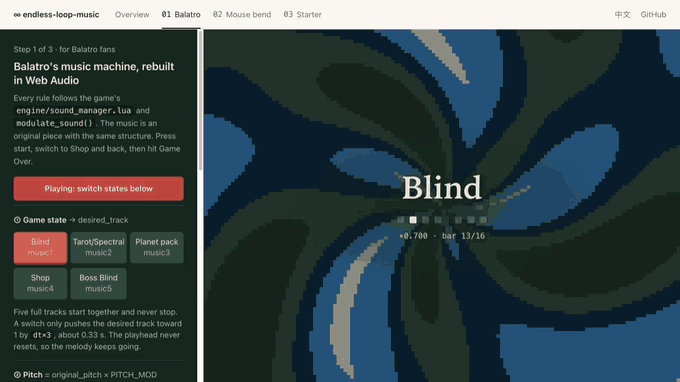
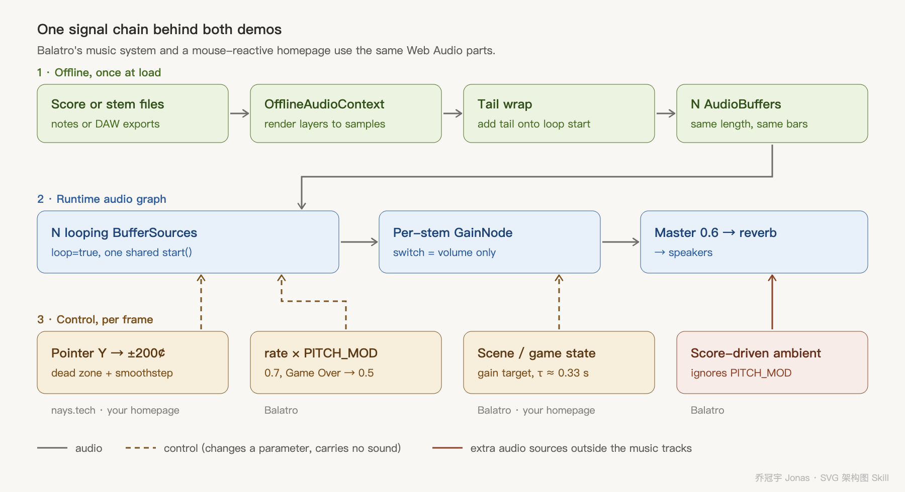

# endless-loop-music

**How a short loop can sound like it never ends.** Two browser demos, one small module, and the mechanism behind Balatro's music, checked against the game's source.

**[▶ Play it in your browser](https://jonasjoe233.github.io/endless-loop-music/demos/balatro.html)** · [Put it on your homepage](#use-it-on-your-homepage) · [How it works](#part-2--balatros-music-machine-from-the-source) · [中文版](README.zh-CN.md)

[](https://jonasjoe233.github.io/endless-loop-music/demos/balatro.html)

<sub>Blind → Shop → Boss Blind → Game Over, shown at 2× speed. The live demo plays sound after you click Start.</sub>

**Want it on your own site?** Click **Use this template** or fork the repo. Then follow [Use it on your homepage](#use-it-on-your-homepage). The module has no dependencies and no build step.

## Why this exists

It started with two things I liked.

The first was a personal homepage, [nays.tech](https://nays.tech). Its background music bends in pitch as you move the mouse up and down. It feels alive, and it costs almost nothing to build.

The second was [Balatro](https://www.playbalatro.com/). I have played it for hours, and its music never feels like a loop. I don't hear a start or an end. It feels like the track keeps producing new material.

I dug into both. They turned out to use the same few Web Audio parts. This repo is what I learned, written for two kinds of readers:

- **Balatro fans** who want to know why the soundtrack feels endless.
- **People vibe-coding a personal homepage** who want reactive background music without a heavy audio engine.

I will use this on my own homepage, and the homepage links back here.

## What's inside

| | Open | What you hear |
|---|---|---|
| Balatro music machine | [Play](https://jonasjoe233.github.io/endless-loop-music/demos/balatro.html) · [`demos/balatro.html`](demos/balatro.html) | Five synced tracks, the 0.7× slowdown, a Game Over tape stop, and score-driven ambient layers. |
| Mouse bend lab | [Play](https://jonasjoe233.github.io/endless-loop-music/demos/mouse-bend.html) · [`demos/mouse-bend.html`](demos/mouse-bend.html) | The nays.tech pitch curve, plus switches for coprime loop lengths, slow drift and scene crossfades. |
| Homepage starter | [Play](https://jonasjoe233.github.io/endless-loop-music/examples/homepage.html) · [`examples/homepage.html`](examples/homepage.html) | About 75 lines that use `src/endless-loop.js`. Copy it into your site. |
| Module | [`src/endless-loop.js`](src/endless-loop.js) | Zero dependencies, about 120 lines. |

All audio is synthesized in the browser, so the repo ships no sound files. The music in the Balatro demo is an original piece written with the same structure. It is not the game's soundtrack.

Both demos share one signal chain:



## Part 1 · The homepage trick: mouse Y bends the pitch

nays.tech plays one looping track. The cursor's vertical position sets its pitch:

- The middle 32% of the screen is a **dead zone** with no bend. Reading the page does not detune the music.
- Outside the dead zone, a **smoothstep** curve ramps the bend up to **±200 cents** (two semitones) at the top and bottom edges.
- The value is **smoothed twice**: once per animation frame, once by `AudioParam.setTargetAtTime`. Fast mouse flicks sound like a hand on a tape reel, not like zipper noise.

Changing `detune` on an `AudioBufferSourceNode` changes pitch and speed together, the way tape or vinyl behaves. That coupling matters. The music stays one coherent sound, and the loop length keeps shifting a little, so your ear never locks onto a fixed cycle.

```js
function bendCurve(pos /* 0 top … 1 bottom */, range = 200, deadZone = 0.32) {
  const n = 0.5 - pos, a = Math.abs(n), half = deadZone / 2;
  if (a <= half) return 0;
  const t = Math.min(1, (a - half) / (0.5 - half));
  return Math.sign(n) * t * t * (3 - 2 * t) * range;   // cents
}
```

## Part 2 · Balatro's music machine, from the source

Balatro runs on the LÖVE engine. Its music code lives in `engine/sound_manager.lua` and in `modulate_sound()` in `functions/misc_functions.lua`. I read the [community reverse-engineered source](https://github.com/balatro-src/balatro-src-reverse-engineering) and rebuilt each rule in Web Audio.

**1. Five full tracks always play together.** `music1` to `music5` start at the same moment and never stop. The game state only picks which one is audible:

| Track | Game state |
|---|---|
| `music1` | Normal blind |
| `music2` | Tarot or Spectral pack |
| `music3` | Planet pack |
| `music4` | Shop |
| `music5` | Boss blind |

**2. A switch only moves volumes.** Every frame, the desired track's volume moves toward 1 and the others move toward 0: `vol = target·(dt·3) + (1 − dt·3)·vol`. That is an exponential fade with a time constant of about 0.33 s. The playhead never resets, so the melody carries straight through the shop, the pack and the boss.

**3. All music plays at 0.7×.** The pitch factor is `0.7`. In LÖVE, `setPitch` resamples, so pitch and speed move together, like the mouse bend above:

| | Value |
|---|---|
| Speed | 30% slower; one loop lasts 1.43× as long |
| Pitch | 1200·log₂(0.7) ≈ **−617.5 cents**, about 6.2 semitones lower |
| Tuning | 17.5 cents away from the nearest semitone, a little "off", like old tape |
| Timbre | Every overtone moves down too, so the mix sounds darker and softer |

**4. Game Over is a tape stop.** A second factor, `PITCH_MOD`, moves toward 0.5 at rate `dt` per frame (about 63% of the way each second). The music slows and sinks until you restart.

**5. Ambient layers follow your score.** On top of the music, a looping organ drone fades in only when your hand beats the blind's target:

```lua
organ = max(min(0.4, 0.1 * log5(earned / (required + 1))), 0)
```

Fire sounds follow the intensity of the scoring flames. These layers are separate sources. They use their own fixed pitch and **ignore `PITCH_MOD`**, so they keep burning during a Game Over slowdown.

**6. Restart instead of loop.** The game does not use the engine's native loop flag. When the tracks end, it restarts all five together so they stay in sync. In the browser, `loop = true` on buffers of identical length gives the same result with less code.

## Part 3 · Why it sounds endless: the music side

The code keeps the audio continuous. The music has to hide the seam. These are the techniques, and the Balatro demo uses all of them:

- **Vertical remixing.** The five tracks are one piece in five arrangements: same chords, same tempo, same bar lines. A crossfade at any moment lands on the beat. You hear the band change instruments, not a new song starting.
- **Resolve across the seam.** The last bar is A7, the dominant. The first bar is Dm9, the tonic. The loop point is heard as a normal cadence (V → i), which the ear reads as "arriving", not "starting over".
- **Rootless voicings and modal melody.** Jazz-style chords without the root (the bass plays it) sound soft and open. A D dorian melody fits every chord in the loop, so nothing clashes no matter how often it repeats.
- **Slow it down.** At 0.7× the tempo drops from 100 to 70 BPM and a 16-bar loop grows to about 96 s. The longer the cycle, the harder it is to remember where it began.
- **Seven beats to the bar.** All five game themes are in 7/4 ([Balatro Wiki](https://balatrowiki.org/w/Music)), and so is the remake, felt as 4+3. The bar runs three beats past where a 4/4 ear expects it to end, so the loop is harder to count and harder to place.
- **Events you cause.** The organ and fire layers arrive when you score. Their timing depends on how you play, so each pass through the same loop has different material on top. That is the "new content keeps appearing" feeling.
- **Fold the tail.** Notes near the end ring past the loop point. Instead of cutting them off, add that tail onto the beginning of the buffer. The seam then contains the same reverb and release as any other moment.

The mouse bend lab adds two techniques that Balatro does not need but a homepage might:

- **Coprime loop lengths.** Stems of 16, 7 and 9 beats only line up again after 1008 beats. Brian Eno used this idea in *Music for Airports*.
- **Slow pitch drift.** Two slow sines with unrelated periods modulate the pitch, so no two passes are identical.

## Use it on your homepage

```html
<button id="play">▶ Play sound</button>
<script type="module">
  import { createEndlessLoop } from './endless-loop.js';

  const loop = await createEndlessLoop({
    stems: [
      { url: 'pad.mp3',   loopSeconds: 9.6 },          // exported with a tail; the module folds it back
      { url: 'drums.mp3', loopSeconds: 9.6, gain: 0 }, // silent until a scene turns it up
    ],
    rate: 0.85,       // optional Balatro-style slowdown
    range: 200,       // max mouse bend in cents
  });

  document.getElementById('play').onclick = () => { loop.start(); loop.followPointer(); };
  // later: loop.setScene([1, 1]); loop.setRate(0.5); loop.mute(true);
</script>
```

API: `start()`, `followPointer()`, `setBend(cents)`, `setRate(rate)`, `setScene(gains[])`, `mute(bool)`, `destroy()`. The module also suspends audio when the tab is hidden.

**Preparing stems in a DAW**

1. Make every stem exactly the same number of bars, at the same tempo.
2. Export each stem with a few extra seconds after the last bar, so reverb tails are included. Pass the exact loop length as `loopSeconds`.
3. End the loop on a chord that leads back to the first one.
4. Keep the files small. A 10 to 20 s loop in mono MP3 or Opus at 96 kbps is about 120 to 240 KB per stem.

**Be kind to visitors**

- Browsers block audio until the visitor clicks. Always use a visible play button, and never autoplay.
- Give a mute control that stays on screen.
- Keep the volume low (the default master is 0.6) and the bend range moderate. ±200 cents is lively. ±50 is subtle.

**A prompt for your AI coding tool**

> Add background music to my homepage using `endless-loop.js` from github.com/JonasJoe233/endless-loop-music. Load my stems `a.mp3` and `b.mp3` (each loop is N seconds; the files include a tail). Start audio on a visible play button, follow the pointer for pitch bend with the default curve, add a mute toggle, and fade in stem `b` when the visitor scrolls past the hero section.

## What is verified and what is mine

**From the Balatro source:** five synced tracks and their state mapping, the `dt·3` crossfade, the 0.7 pitch factor, the Game Over target of 0.5, the log₅ organ curve capped at 0.4, ambient layers ignoring `PITCH_MOD`, and the 0.6 music volume.

**From nays.tech's front-end behavior:** the ±200 cent range, the 32% dead zone, the smoothstep curve and the two smoothing stages. I read these from the site's front-end behavior and code. No code was copied.

**My own choices:** all compositions and sounds, the mix of each track, the reverb, and the fire-intensity formula. The game derives fire from its scoring animation. The demo approximates it from the score ratio.

## Run locally

The demos in `demos/` open directly from disk. `examples/homepage.html` uses an ES module import, so serve the folder:

```sh
python3 -m http.server 8000   # then open http://localhost:8000
```

## Built something with it?

Open an [issue](https://github.com/JonasJoe233/endless-loop-music/issues/new) with a link to your page. I will add a list of sites that use it here. If the repo helped you, a star helps other people find it.

## Credits

- Balatro is made by LocalThunk and published by Playstack. Its soundtrack is by LouisF. This project is not affiliated with or endorsed by them, and it contains no game assets.
- Thanks to the maintainers of the reverse-engineered Balatro source for making the sound code readable.
- Thanks to [nays.tech](https://nays.tech) for the idea of a homepage that responds as you move.
- Built by Jonas Qiao with Claude (Anthropic) as the AI coding assistant. Most of the code, docs and demos were written through AI-assisted development. I set the direction, made the calls and checked the results.

## License

[MIT](LICENSE) for the code and the original music in this repo.
