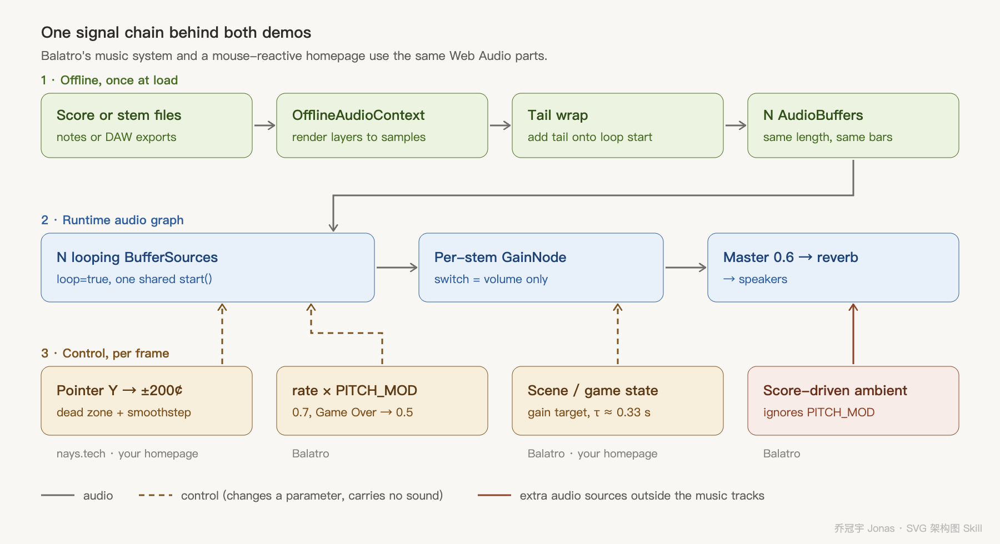

# endless-loop-music

**一段很短的循环，怎么听起来永远不结束。** 本仓库有两个浏览器 demo 和一个小模块。小丑牌（Balatro）的音乐机制也在这里，已对照游戏源码核实。

[English](README.md) · [在线 demo](https://JonasJoe233.github.io/endless-loop-music/)



## 起因

起因是我喜欢的两样东西。

第一样是个人主页 [nays.tech](https://nays.tech)。鼠标上下移动时，它的背景音乐会跟着变调。效果很生动，做起来却很便宜。

第二样是[小丑牌](https://www.playbalatro.com/)。我玩了很久，它的音乐从来不像循环。我听不到开头和结尾，只觉得曲子一直在冒出新内容。

我把两者都拆开看了。它们用的是同一套 Web Audio 零件。这个仓库记录我学到的东西，写给两类读者：

- **小丑牌玩家**：想知道配乐为什么听起来没有尽头。
- **用 vibe coding 做个人主页的人**：想要会响应的背景音乐，又不想引入沉重的音频引擎。

我自己的主页也会用这套做法，主页上会链接回这里。

## 仓库内容

| | 打开 | 能听到什么 |
|---|---|---|
| 小丑牌音乐机制 | [`demos/balatro.html`](demos/balatro.html) | 五轨同步、0.7 倍放慢、Game Over 磁带停转、随得分出现的环境层。 |
| 鼠标变调实验 | [`demos/mouse-bend.html`](demos/mouse-bend.html) | nays.tech 的变调曲线，外加互质循环长度、慢速漂移、场景交叉淡化的开关。 |
| 主页模板 | [`examples/homepage.html`](examples/homepage.html) | 约 75 行，调用 `src/endless-loop.js`。可直接拷进你的网站。 |
| 模块 | [`src/endless-loop.js`](src/endless-loop.js) | 零依赖，约 120 行。 |

所有声音都在浏览器里合成，仓库不带任何音频文件。小丑牌 demo 的曲子按同样结构原创，不是游戏原声。

## 第一部分：主页的做法，鼠标高度控制音高

nays.tech 只放一条循环音轨。光标的纵向位置决定音高：

- 屏幕中间 32% 是**死区**，这里不变调。读正文时音乐不会跑调。
- 离开死区后，用 **smoothstep** 曲线把变调推到上下边缘的 **±200 音分**，即两个半音。
- 数值经过**两次平滑**：每帧一次，`AudioParam.setTargetAtTime` 再一次。鼠标甩得很快时，听感像手按磁带盘，不会有毛刺声。

改 `AudioBufferSourceNode` 的 `detune`，音高和速度会一起变，和磁带、黑胶一样。这个联动很关键。音乐始终是一个整体，循环长度也在轻微变化，耳朵抓不住固定的周期。

```js
function bendCurve(pos /* 0 顶部 … 1 底部 */, range = 200, deadZone = 0.32) {
  const n = 0.5 - pos, a = Math.abs(n), half = deadZone / 2;
  if (a <= half) return 0;
  const t = Math.min(1, (a - half) / (0.5 - half));
  return Math.sign(n) * t * t * (3 - 2 * t) * range;   // 音分
}
```

## 第二部分：小丑牌的音乐机制（来自源码）

小丑牌基于 LÖVE 引擎。音乐代码在 `engine/sound_manager.lua`，以及 `functions/misc_functions.lua` 的 `modulate_sound()`。我读的是[社区逆向整理的源码](https://github.com/balatro-src/balatro-src-reverse-engineering)，再用 Web Audio 逐条复刻。

**1. 五条完整音轨一直同时播放。** `music1` 到 `music5` 同一时刻起播，永不停止。游戏状态只决定哪条能听见：

| 音轨 | 游戏状态 |
|---|---|
| `music1` | 普通盲注 |
| `music2` | 塔罗包或幻灵包 |
| `music3` | 星球包 |
| `music4` | 商店 |
| `music5` | Boss 盲注 |

**2. 切换只改音量。** 每帧里，目标音轨的音量向 1 靠近，其余向 0 靠近：`vol = target·(dt·3) + (1 − dt·3)·vol`。这是指数淡化，时间常数约 0.33 秒。播放头从不归零，所以旋律会一路穿过商店、卡包和 Boss。

**3. 所有音乐以 0.7 倍播放。** 音高系数是 `0.7`。LÖVE 的 `setPitch` 是重采样，音高和速度一起变，和上面的鼠标变调一样：

| | 数值 |
|---|---|
| 速度 | 慢 30%，一遍循环拉长到 1.43 倍 |
| 音高 | 1200·log₂(0.7) ≈ **−617.5 音分**，约低 6.2 个半音 |
| 音准 | 离最近的半音差 17.5 音分，略「不准」，像旧磁带 |
| 音色 | 所有泛音一起下移，整体更暗、更柔 |

**4. Game Over 是磁带停转。** 第二个系数 `PITCH_MOD` 每帧按 `dt` 向 0.5 靠近，每秒走完剩余距离的约 63%。音乐会越来越慢、越来越低，直到你重开。

**5. 环境层跟着得分走。** 音乐之上还有一层循环的管风琴长音。只有本手得分超过盲注目标时，它才淡入：

```lua
organ = max(min(0.4, 0.1 * log5(earned / (required + 1))), 0)
```

火焰声跟随计分火焰的强度。这些层是独立的音源，用自己的固定音高，**不受 `PITCH_MOD` 影响**。所以 Game Over 降速时，火还在照常烧。

**6. 用重启代替循环。** 游戏没有用引擎的原生循环。音轨播完时，它把五条一起重启，以保持同步。在浏览器里，给等长的 buffer 设 `loop = true`，效果相同，代码更少。

## 第三部分：为什么听起来没有尽头（音乐层面）

代码保证声音不断。接缝要靠音乐本身藏起来。下面是用到的手法，小丑牌 demo 全部用上了：

- **纵向混音。** 五条音轨是同一首曲子的五种配器：和弦、速度、小节线都相同。任何时刻交叉淡化都对得上拍。你听到的是乐队换了编制，不是换了一首歌。
- **在接缝处解决。** 最后一小节是 A7，属和弦。第一小节是 Dm9，主和弦。循环点听起来是一次正常的终止（V → i），耳朵感到「到达」，不会觉得「重来」。
- **无根音和弦与调式旋律。** 爵士式的和弦不弹根音，根音交给贝斯，听起来柔和开放。旋律用 D 多利亚音阶，放在循环里每个和弦上都合适，重复多少遍也不冲突。
- **放慢。** 0.7 倍时速度从 100 BPM 降到 70 BPM，16 小节的循环拉长到约 55 秒。周期越长，越难记住它从哪里开始。
- **由你触发的事件。** 管风琴和火焰层在你得分时出现。它们的时机取决于你怎么打，所以同一段循环每一遍上面叠的东西都不同。这就是「一直有新内容」的感觉。
- **尾音回卷。** 结尾的音会响过循环点。不要截掉它们，而是把这段尾音叠到 buffer 开头。这样接缝处和其他时刻一样，带着同样的混响和余音。

鼠标变调实验多加了两个手法。小丑牌用不着，个人主页可能用得上：

- **互质的循环长度。** 16、7、9 拍的分轨，要 1008 拍才会再次对齐。Brian Eno 在《Music for Airports》里用过这个思路。
- **慢速音高漂移。** 两条周期互不相关的慢正弦调制音高，所以任意两遍都不完全相同。

## 用到你的个人主页

```html
<button id="play">▶ Play sound</button>
<script type="module">
  import { createEndlessLoop } from './endless-loop.js';

  const loop = await createEndlessLoop({
    stems: [
      { url: 'pad.mp3',   loopSeconds: 9.6 },          // 导出时带尾音，模块会把它折回开头
      { url: 'drums.mp3', loopSeconds: 9.6, gain: 0 }, // 先静音，等场景把它推上来
    ],
    rate: 0.85,       // 可选：小丑牌式放慢
    range: 200,       // 鼠标最大变调，单位音分
  });

  document.getElementById('play').onclick = () => { loop.start(); loop.followPointer(); };
  // 之后：loop.setScene([1, 1]); loop.setRate(0.5); loop.mute(true);
</script>
```

API：`start()`、`followPointer()`、`setBend(cents)`、`setRate(rate)`、`setScene(gains[])`、`mute(bool)`、`destroy()`。标签页隐藏时，模块会自动暂停音频。

**在 DAW 里准备分轨**

1. 让每条分轨的小节数完全相同，速度也相同。
2. 导出时在最后一小节后多留几秒，把混响尾音带上。把准确的循环长度传给 `loopSeconds`。
3. 让循环结束在一个能引回第一个和弦的和弦上。
4. 控制文件大小。10 到 20 秒的循环，用单声道 96 kbps 的 MP3 或 Opus，每条约 120 到 240 KB。

**照顾访客**

- 浏览器在访客点击前会拦截音频。一定放一个看得见的播放按钮，不要自动播放。
- 提供一个一直在屏幕上的静音开关。
- 音量放低（默认总音量 0.6），变调范围适中。±200 音分很活泼，±50 很含蓄。

**给 AI 编程工具的 prompt**

> Add background music to my homepage using `endless-loop.js` from github.com/JonasJoe233/endless-loop-music. Load my stems `a.mp3` and `b.mp3` (each loop is N seconds; the files include a tail). Start audio on a visible play button, follow the pointer for pitch bend with the default curve, add a mute toggle, and fade in stem `b` when the visitor scrolls past the hero section.

## 哪些已核实，哪些是我的选择

**来自小丑牌源码：** 五轨同步及其状态对应、`dt·3` 交叉淡化、0.7 音高系数、Game Over 目标 0.5、上限 0.4 的 log₅ 管风琴曲线、环境层不受 `PITCH_MOD` 影响、音乐音量 0.6。

**来自 nays.tech 的前端行为：** ±200 音分范围、32% 死区、smoothstep 曲线、两级平滑。这些是从网站的前端行为和代码里读出来的，没有复制代码。

**我自己的选择：** 所有曲子和音色、每条音轨的混音比例、混响、火焰强度公式。游戏的火焰强度来自计分动画，demo 用得分倍数来近似。

## 本地运行

`demos/` 里的页面可以直接双击打开。`examples/homepage.html` 用了 ES module 导入，需要起一个静态服务：

```sh
python3 -m http.server 8000   # 然后打开 http://localhost:8000
```

## 致谢

- 小丑牌由 LocalThunk 开发，Playstack 发行，配乐作者是 LouisF。本项目与他们无关，也未获其背书，不含任何游戏素材。
- 感谢逆向整理小丑牌源码的维护者，让音频代码变得可读。
- 感谢 [nays.tech](https://nays.tech) 提供「主页随鼠标响应」的灵感。

## 许可

本仓库的代码和原创音乐采用 [MIT](LICENSE) 许可。
